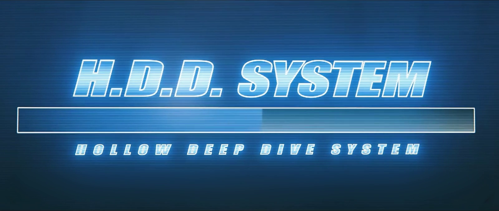
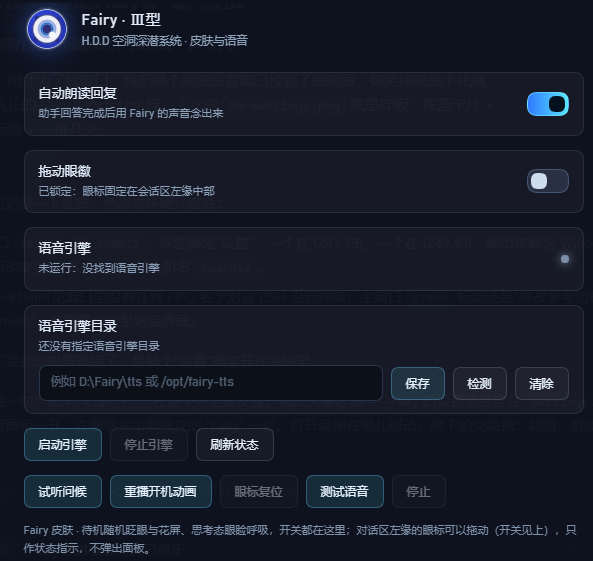

# Fairy Ⅲ · 绝区零 H.D.D 皮肤

**中文** · [English](#english)

把 DeepSeek Harness 的 Web 界面换成《绝区零》Fairy 的 H.D.D 终端：满屏开机动画 → 居中问好 → 收成会话区左侧的常驻眼徽，并可用本地 GPT-SoVITS 的 Fairy 音色把回复念出来。




| 眼徽状态 | 设置面板 |
| --- | --- |
|  |  |

## 特性

- **开机动画**：整屏播放 H.D.D 启动片，视频按 `object-fit: contain` 完整显示，多余区域由同帧的模糊铺底填充，任何窗口比例都不会出现硬黑边。启动片自带音轨：页面允许自动播放时直接带声音放，被浏览器拦下就先静音播放，等你第一次点按/敲键再把声音打开。
- **居中问好**：动画结束后淡入 H.D.D 眼徽（深蓝环 / 白盘 / 蓝瞳 / 高光点），背后是蓝光晕图，`HOLLOW DEEP DIVE SYSTEM` 标题带镜面倒影，下方按当前时段（凌晨/上午/中午/下午/傍晚/深夜）播一句问候并同步播放预录音频。
- **收成眼徽**：问候结束约 1.9s 后眼徽飞到会话区左缘的中线（侧栏右侧的蓝色圈内）常驻，光晕图淡出。默认可以按住拖到屏幕任意位置，坐标写进 `localStorage`，刷新后仍在原位；不想要拖动就去 `设置 → Fairy` 关掉「拖动眼徽」，或用「眼标复位」回到会话区左缘。
- **用量气泡**：单击眼徽弹出一个小气泡，显示 DeepSeek 账户余额、今天的花费（按百万 token 折算，含缓存命中/未命中/输出三段拆分）和当前是高峰还是空闲时段（带倒计时，直接告诉你还有多久换价）；再点一下收起。每轮对话跑完会自动弹一次，这时只报「本轮花费 + 峰谷」，不显示余额与今日合计，18 秒后自己消失。价格表与时段规则都在 `index.js` 的 `PRICES` / `peakState()` 里，改一处就够。
- **状态动效**（复刻参考实现 Fairy-DSH 的几何与时长）：
  - `idle` 呼吸 + 缓慢自转 + 扫描光带；
  - `thinking/working` 上眼睑压到半闭并轻微呼吸；
  - 待机随机眨眼（3.4–8.6s 一次，约 24% 概率连眨，眨眼后可能瞟一眼）；
  - 待机随机「花屏」：把整只眼切成 2–4 条横带横向错位；
  - `done` 眼睑轻扫一下。
- **品牌位替换**：隐藏官方 SVG 字标，在原位置叠上 Fairy 眼徽 + 斜体 `Fairy` 字标，位置由量测官方元素得到，随窗口自适应。
- **主题**：深蓝玻璃 + 青蓝霓虹 token、网格与扫描线壁纸、H.D.D 风滚动条与焦点光。
- **语音**：开场问候是预录 wav（不依赖引擎）；后续回复可自动朗读或点按钮朗读，走本地 GPT-SoVITS（CPU 推理）。
- **设置面板**：DSH 的「设置 → Fairy」里集中管理朗读开关、引擎状态、引擎目录、试听/重播/测试。

## 安装

需要 DeepSeek Harness（插件只在运行时调用宿主提供的槽位与 webServer，不直接 import `@deepseek-ai/*`）。

**方式一：让 agent 装（推荐）**

```text
git clone https://github.com/AssassinVIX/fairy-zzz-plugin.git
```

然后在 DSH 会话里：

```text
plugin_manager install_bundle  target=<克隆下来的目录>
```

**方式二：手动合并 patch**

把本仓库根目录 `cordis.patch.yml` 里的**两个** `insert` 段一起合并进你的 profile patch（Windows 一般是 `%USERPROFILE%\.dsh\profiles\<profile>\cordis.patch.yml`）：

```yaml
- insert:
    - id: fairy-zzz-skin
      name: 'dsh-fairy-zzz'

- insert:
    - id: preset-fairy
      name: '@deepseek-ai/dsh-agent-preset'
      config: { ... }   # 完整内容见仓库里的 cordis.patch.yml
```

装好后整页刷新一次。皮肤只做「插入一行 + 宿主注册两条 HTTP 路由」，不修改宿主的任何文件。

**方式三：Windows 一键脚本**

```powershell
powershell -ExecutionPolicy Bypass -File .\install-windows.ps1            # 装
powershell -ExecutionPolicy Bypass -File .\install-windows.ps1 -Uninstall  # 卸
```

脚本会自己找 profile、把插件放进 `node_modules\dsh-fairy-zzz`、补 patch、把浅色主题改成深色。不放心脚本改文件的话用方式一/二。

> **从旧版升级**：1.0.0 起包名从 `@local/dsh-fairy-zzz` 改成 `dsh-fairy-zzz`（为了能被收录与 npm 安装）。
> 老安装请把 profile patch 里的 `name: '@local/dsh-fairy-zzz'` 改成 `name: 'dsh-fairy-zzz'`，
> 并把插件目录从 `node_modules\@local\dsh-fairy-zzz` 换到 `node_modules\dsh-fairy-zzz`。


## 「Fairy 模式」预设（随插件安装）

插件自带的 `cordis.patch.yml` 里除了皮肤本体，还插入了 `preset-fairy`——**只装人设**的 agent 预设：
预设里只有 `@deepseek-ai/dsh-persona` 一项，不带任何工具、上下文或其它插件，工具集沿用你当前 DSH 的配置，
预设只负责 Fairy 的语气与身份。装好插件、重启 DSH 后，新建会话的模式选择器里就会多出「Fairy 模式」。

`presets/fairy-mode.patch.yml` 是同一份内容的**独立版**，留给「只想用人设、不装皮肤」的人单独合并进 profile patch。

> 如果你以前手动往 profile patch 里追加过 `preset-fairy`，请把旧的那段删掉，否则会出现两份同名预设。
> 皮肤本体与这个预设互不依赖：不装预设也有皮肤，不装皮肤也能用预设。

## 设置（设置 → Fairy）

| 控件 | 说明 |
| --- | --- |
| 自动朗读回复 | 助手回答完成后自动念出来；关掉也可以单独点消息旁的朗读按钮 |
| 拖动眼徽 | 默认开启：按住会话区左缘的眼标拖到屏幕任意位置，位置记在浏览器里；关掉则锁回会话区左缘 |
| 语音引擎 | 引擎状态灯：绿=就绪，黄=启动中，灰=未运行 |
| 语音引擎目录 | 输入引擎目录 → `保存`（写入 `<插件目录>/voice-home.txt`）、`检测`（只校验不保存）、`清除`（回到自动探测） |
| 启动引擎 / 停止引擎 | 由宿主进程托管引擎的启停 |
| 刷新状态 | 立即重新探测一次 |
| 试听问候 / 重播开机动画 | 重放最新问候音频 / 重新走一遍开机 → 问好 → 收成眼徽 |
| 眼标复位 | 忘掉拖动记下的坐标，把眼标放回会话区左缘的默认锚点 |
| 测试语音 / 停止 | 合成一句测试语音 / 停止当前播放 |

## 语音引擎（可选）

皮肤、开机动画、预录问候都不需要引擎；只有「把回复念出来」需要。

引擎目录里需要有：

```text
<引擎目录>/
  fairy_server.py        # 引擎入口（--port 指定端口）
  GPT-SoVITS/            # 引擎本体
  models/                # Fairy 的 .pth / .ckpt 与参考音频
  py311/                 # 可选：便携 Python
```

目录的查找顺序（用户指定的永远优先）：

1. `<插件目录>/voice-home.txt` —— 在设置面板里保存的那个目录；
2. `FAIRY_VOICE_HOME` 环境变量；
3. 插件同级 `voice/`（免安装便携包）；
4. 旧版 `FAIRY_TTS_DIR` 环境变量（兼容）。

都没找到时皮肤照常工作，设置面板会提示去指定目录。

其它环境变量：

| 变量 | 默认 | 说明 |
| --- | --- | --- |
| `FAIRY_TTS_PORT` | `9800` | 引擎监听端口 |
| `FAIRY_CACHE_DIR` | `<插件目录>/cache` | 合成语音与磁盘缓存位置 |

引擎日志写在引擎目录下的 `server.log`。CPU 加载约 20s，加载完成前设置面板显示「启动中」。

## 路由

宿主半边只注册这些只读/本地路由（前缀 `/fairy-zzz`）：

| 方法 | 路径 | 说明 |
| --- | --- | --- |
| GET | `/fairy-zzz/assets/<file>` | `boot.mp4` / `poster.jpg` / `hero.png` / `voice/greet-*.wav`（支持 Range） |
| GET | `/fairy-zzz/audio/<hash>.wav` | 合成语音缓存（支持 Range） |
| POST | `/fairy-zzz/tts` | `{ text }` → `{ url, cached, seconds }`，清 markdown/代码块后截 500 字 |
| GET | `/fairy-zzz/health` | `{ ok, engine, voice, speed, home }` |
| GET | `/fairy-zzz/mood` | `idle` / `thinking` / `working` / `done`（驱动眼徽状态） |
| GET | `/fairy-zzz/usage` | `{ peak, today, turn }`：今日与本轮的 token 用量、折算花费、当前峰谷时段（聚合本机会话日志） |
| GET | `/fairy-zzz/voice-home` | 当前引擎目录与来源 |
| POST | `/fairy-zzz/voice-home` | 保存 / 校验引擎目录 |
| GET | `/fairy-zzz/engine` | 引擎进程状态 |
| POST | `/fairy-zzz/engine` | `{ action: "start" \| "stop" }` |

## 截图是怎么来的

`screenshots/` 里的图不是外链：开机帧取自 `assets/boot.mp4`，其余是离线渲染（把 `client.js` 里的 CSS 与眼徽 SVG 抽出来，用同一套样式渲染）。仓库里没有运行期依赖，也没有构建产物。

## 已知限制

- 官方字标是内联 SVG，没有可替换的文本节点；`sidebar.brand.mark/name` 又是 `single` 槽位、宿主先注册者常驻，所以皮肤用「隐藏官方字标 + 在同一位置叠自己的字标」来实现，不是真正的槽位替换。官方的 DOM 结构一改就可能要跟着调选择器。
- 桌面壳的窗口标题、菜单、侧栏条目文案属于应用本身，插件改不了。
- 与其它抢占左下/右下角落的插件（鲸鱼挂件、桌宠）同时开时观感会打架。
- 语音引擎是可选外部依赖，仓库不含权重与引擎本体。

## 排错

| 现象 | 处理 |
| --- | --- |
| 设置里引擎一直「未运行」 | 检查引擎目录是否含 `fairy_server.py`、`GPT-SoVITS/`、`models/`；看 `<引擎目录>/server.log` |
| 保存目录后仍显示旧路径 | 旧的宿主进程没有 `voice-home` 路由，重启一次 DSH |
| 回复不朗读但问候能播 | 问候是预录 wav，不走引擎；引擎没起来时只有朗读会静默失败 |
| 眼徽/字标没出现 | 确认 profile patch 里有 `fairy-zzz-skin` 这一行，并整页刷新 |

## 目录结构

```text
cordis.patch.yml     # 两个 insert：皮肤本体 + 「Fairy 模式」预设
client.js            # 客户端：主题、开机/问好/眼徽、设置面板、语音动作
index.js             # 宿主：静态资源、TTS 队列与缓存、心情、引擎托管
assets/              # boot.mp4 / poster.jpg / hero.png / voice/greet-*.wav
presets/             # 「Fairy 模式」预设的独立版（不装皮肤时单独用）
screenshots/         # 列表用截图
install-windows.ps1  # Windows 安装/卸载脚本
```

## 致谢与许可

- 本仓库代码以 **MIT** 发布（见 `LICENSE`）。
- 眼徽 SVG、动画几何与时长、眼睑/眨眼实现参考了 [Chengzhibense/Fairy-DSH](https://github.com/Chengzhibense/Fairy-DSH)（Apache-2.0，commit 见 `NOTICE-fairy-dsh.md`）；对照视频为 BV1SD4C63EZz「可能是全网最还原的Fairy」。
- 开机视频素材与角色形象版权归 miHoYo / HoYoverse 所有，这里只做个人桌面的视觉改造，请勿用于商业用途。

---

# English

[中文](README.md) · **English**

A **Fairy Ⅲ · Zenless Zone Zero H.D.D skin** for DeepSeek Harness.

It turns the DSH web interface into Fairy's H.D.D terminal: a full-screen boot animation, then a centered greeting, then the emblem tucks itself into a permanent eye badge at the left edge of the conversation area — and replies can be read aloud in a local GPT-SoVITS Fairy voice.


| Eye badge states | Settings panel |
| --- | --- |
|  |  |

## Features

- **Boot animation** — the H.D.D startup clip fills the screen with `object-fit: contain`, and the leftover area is filled with a blurred copy of the same frame, so no hard black bars appear at any window ratio. The clip carries its own audio track: it plays with sound when the page allows autoplay, otherwise it starts muted and unmutes on your first click or keypress.
- **Centered greeting** — when the clip ends, the H.D.D eye badge (deep-blue ring / white disc / blue iris / highlight dot) fades in over a blue glow, with a mirrored `HOLLOW DEEP DIVE SYSTEM` title and a time-of-day greeting (small hours / morning / noon / afternoon / evening / late night) played together with a matching pre-recorded audio clip.
- **Badge hand-off** — about 1.9 s after the greeting the badge flies to the middle of the left edge of the conversation area (inside the blue ring next to the sidebar) and stays there while the glow fades out. It is draggable by default: hold it and move it anywhere on screen — the position is stored in `localStorage` and survives a reload. Turn "Draggable badge" off under *Settings → Fairy*, or use "Reset badge" to snap it back to the left edge of the conversation area.
- **Usage bubble** — a click on the badge pops a small card with your DeepSeek balance, today's spend (converted per million tokens, split into cache-hit / cache-miss / output) and whether you are in the peak or off-peak window, with a live countdown to the next price switch; click again to dismiss. It also pops by itself at the end of every turn, and that one only reports the turn's cost plus the peak/off-peak state — no balance, no daily total — then disappears after 18 s. The price table and the window rule live in `PRICES` / `peakState()` in `index.js`.
- **State animations** (geometry and timings replicate the reference implementation, Fairy-DSH):
  - `idle` — breathing, slow rotation, a sweeping scan light;
  - `thinking` / `working` — the upper eyelid drops to half-closed and breathes slightly;
  - random blinks while idle (every 3.4–8.6 s, ~24% chance of a double blink, sometimes followed by a glance);
  - random idle "glitch" — the whole eye is sliced into 2–4 horizontal bands and shifted sideways;
  - `done` — a quick eyelid sweep.
- **Brand slot replacement** — the official SVG wordmark is hidden and the Fairy eye badge plus an italic `Fairy` wordmark are overlaid in the same spot, positioned from measurements of the official element so it stays responsive.
- **Theme** — deep-blue glass with cyan neon tokens, grid and scanline wallpaper, an H.D.D-style scrollbar and focus glow.
- **Voice** — the opening greeting is a pre-recorded wav and needs no engine; later replies can be read aloud automatically or with a per-message button through a local GPT-SoVITS (CPU inference).
- **Settings panel** — DSH's *Settings → Fairy* manages the read-aloud switch, engine status, engine directory, sampling, replay and tests.

## Install

Requires DeepSeek Harness. The plugin only uses the host slots and `webServer` passed at runtime; it never imports `@deepseek-ai/*`.

**Option 1 — let an agent install it (recommended)**

```text
git clone https://github.com/AssassinVIX/fairy-zzz-plugin.git
```

then, in a DSH session:

```text
plugin_manager install_bundle  target=<path to the cloned folder>
```

**Option 2 — merge the patch by hand**

Merge **both** `insert` blocks from `cordis.patch.yml` into your profile patch (on Windows usually `%USERPROFILE%\.dsh\profiles\<profile>\cordis.patch.yml`):

```yaml
- insert:
    - id: fairy-zzz-skin
      name: 'dsh-fairy-zzz'

- insert:
    - id: preset-fairy
      name: '@deepseek-ai/dsh-agent-preset'
      config: { ... }   # full content lives in cordis.patch.yml
```

Reload the whole page once installed. The skin only inserts one line and registers two HTTP routes on the host; it does not modify any file that ships with DSH.

**Option 3 — Windows one-click script**

```powershell
powershell -ExecutionPolicy Bypass -File .\install-windows.ps1            # install
powershell -ExecutionPolicy Bypass -File .\install-windows.ps1 -Uninstall  # uninstall
```

The script finds your profile, copies the plugin into `node_modules\dsh-fairy-zzz`, adds the patch and switches a light theme to dark. If you would rather not let a script edit files, use option 1 or 2.

> **Upgrading from older versions**: from 1.0.0 the package name changed from `@local/dsh-fairy-zzz` to `dsh-fairy-zzz` (so it can be listed and installed from npm). Change `name: '@local/dsh-fairy-zzz'` to `name: 'dsh-fairy-zzz'` in your profile patch, and move the plugin directory from `node_modules\@local\dsh-fairy-zzz` to `node_modules\dsh-fairy-zzz`.

> The plugin's own `cordis.patch.yml` also inserts `preset-fairy`, a **persona-only** "Fairy mode" agent preset (snarky AI tone, addresses you as "Master"). It only contributes the persona — tools and context plugins come from your DSH configuration, so it keeps working across DSH versions. After installing the plugin and restarting DSH, "Fairy 模式" shows up in the new-session mode picker. `presets/fairy-mode.patch.yml` is the standalone copy for people who want the persona without the skin; if you previously added `preset-fairy` by hand, remove the old block to avoid two presets with the same name.

## Settings (Settings → Fairy)

| Control | What it does |
| --- | --- |
| Read replies aloud | Speaks each assistant answer when it finishes; with it off you can still use the speaker button next to a message |
| Draggable badge | On by default: hold the eye badge at the left edge of the conversation area and drag it anywhere on screen; the position is remembered. Off pins it back to the conversation area's left edge |
| Voice engine | Engine status light: green = ready, yellow = starting, grey = not running |
| Engine directory | Type a directory → `Save` (writes `<plugin dir>/voice-home.txt`), `Detect` (validate without saving), `Clear` (back to auto-detection) |
| Start / Stop engine | Host-managed engine start and stop |
| Refresh status | Re-probe immediately |
| Play greeting / Replay boot | Replay the latest greeting audio / run the boot → greeting → badge sequence again |
| Reset badge | Forget the remembered drag position and snap the badge back to the conversation area's left edge |
| Test voice / Stop | Synthesize a test line / stop current playback |

## Voice engine (optional)

The skin, the boot animation and the pre-recorded greeting need no engine — only "read replies aloud" does.

The engine directory must contain:

```text
<engine dir>/
  fairy_server.py        # entry point (--port)
  GPT-SoVITS/            # the engine itself
  models/                # Fairy's .pth / .ckpt and reference audio
  py311/                 # optional: portable Python
```

Lookup order (a user-specified directory always wins):

1. `<plugin dir>/voice-home.txt` — the directory saved in the settings panel;
2. the `FAIRY_VOICE_HOME` environment variable;
3. `voice/` next to the plugin (portable bundle);
4. the legacy `FAIRY_TTS_DIR` environment variable (compatibility).

If none of them is found the skin still works, and the settings panel points you to the directory field.

Other environment variables:

| Variable | Default | Description |
| --- | --- | --- |
| `FAIRY_TTS_PORT` | `9800` | Port the engine listens on |
| `FAIRY_CACHE_DIR` | `<plugin dir>/cache` | Where synthesized audio and the disk cache go |

Engine logs are written to `server.log` in the engine directory. Loading on CPU takes about 20 s; until it finishes the settings panel shows "starting".

## HTTP routes

The host side only registers these read-only/local routes (prefix `/fairy-zzz`):

| Method | Path | Description |
| --- | --- | --- |
| GET | `/fairy-zzz/assets/<file>` | `boot.mp4` / `poster.jpg` / `hero.png` / `voice/greet-*.wav` (Range supported) |
| GET | `/fairy-zzz/audio/<hash>.wav` | Synthesized-audio cache (Range supported) |
| POST | `/fairy-zzz/tts` | `{ text }` → `{ url, cached, seconds }`; strips markdown/code blocks and truncates to 500 characters |
| GET | `/fairy-zzz/health` | `{ ok, engine, voice, speed, home }` |
| GET | `/fairy-zzz/mood` | `idle` / `thinking` / `working` / `done` (drives the badge) |
| GET | `/fairy-zzz/usage` | `{ peak, today, turn }`: token usage and converted cost for today and the current turn, plus the current peak/off-peak window (aggregated from local session logs) |
| GET | `/fairy-zzz/voice-home` | Current engine directory and where it came from |
| POST | `/fairy-zzz/voice-home` | Save / validate the engine directory |
| GET | `/fairy-zzz/engine` | Engine process state |
| POST | `/fairy-zzz/engine` | `{ action: "start" \| "stop" }` |

## How the screenshots were made

The images in `screenshots/` are not remote links: the boot frame is taken from `assets/boot.mp4`, and the rest are rendered offline by extracting the CSS and the eye-badge SVG from `client.js` and rendering them with the same styles. The repository has no runtime dependencies and no build output.

## Known limitations

- The official wordmark is inline SVG with no replaceable text node, and `sidebar.brand.mark/name` are `single` slots that the first registrant keeps, so the skin hides the official wordmark and overlays its own at the same position instead of doing a real slot replacement. If the official DOM changes, the selectors may need updating.
- The desktop shell's window title, menus and sidebar labels belong to the app itself; a plugin cannot change them.
- Other plugins that claim the bottom-left/right corners (whale widget, desktop pet) may look cluttered when enabled together.
- The voice engine is an optional external dependency; the repository ships neither weights nor the engine itself.

## Troubleshooting

| Symptom | Fix |
| --- | --- |
| The engine stays "not running" in Settings | Check that the engine directory has `fairy_server.py`, `GPT-SoVITS/` and `models/`; read `<engine dir>/server.log` |
| The old path is still shown after saving | The old host process has no `voice-home` route; restart DSH once |
| Replies are not spoken but the greeting plays | The greeting is a pre-recorded wav and does not use the engine; with no engine running only read-aloud fails silently |
| No badge or wordmark appears | Check that `fairy-zzz-skin` is in your profile patch and reload the whole page |

## Repository layout

```text
cordis.patch.yml     # two inserts: the skin itself + the "Fairy mode" preset
client.js            # client: theme, boot/greeting/badge, settings panel, voice actions
index.js             # host: static assets, TTS queue and cache, mood, engine supervision
assets/              # boot.mp4 / poster.jpg / hero.png / voice/greet-*.wav
presets/             # standalone copy of the "Fairy mode" preset (persona only, no skin)
screenshots/         # screenshots used above
install-windows.ps1  # Windows install/uninstall script
```

## Credits & license

- The code in this repository is released under the **MIT** license (see `LICENSE`).
- The eye-badge SVG, the animation geometry and timings, and the eyelid/blink implementation reference [Chengzhibense/Fairy-DSH](https://github.com/Chengzhibense/Fairy-DSH) (Apache-2.0; commit in `NOTICE-fairy-dsh.md`); the comparison video is BV1SD4C63EZz「可能是全网最还原的Fairy」.
- The boot video assets and the character likeness belong to miHoYo / HoYoverse. This is a personal desktop visual reskin only — do not use it commercially.

---

[↑ 返回中文 / Back to Chinese](README.md)
